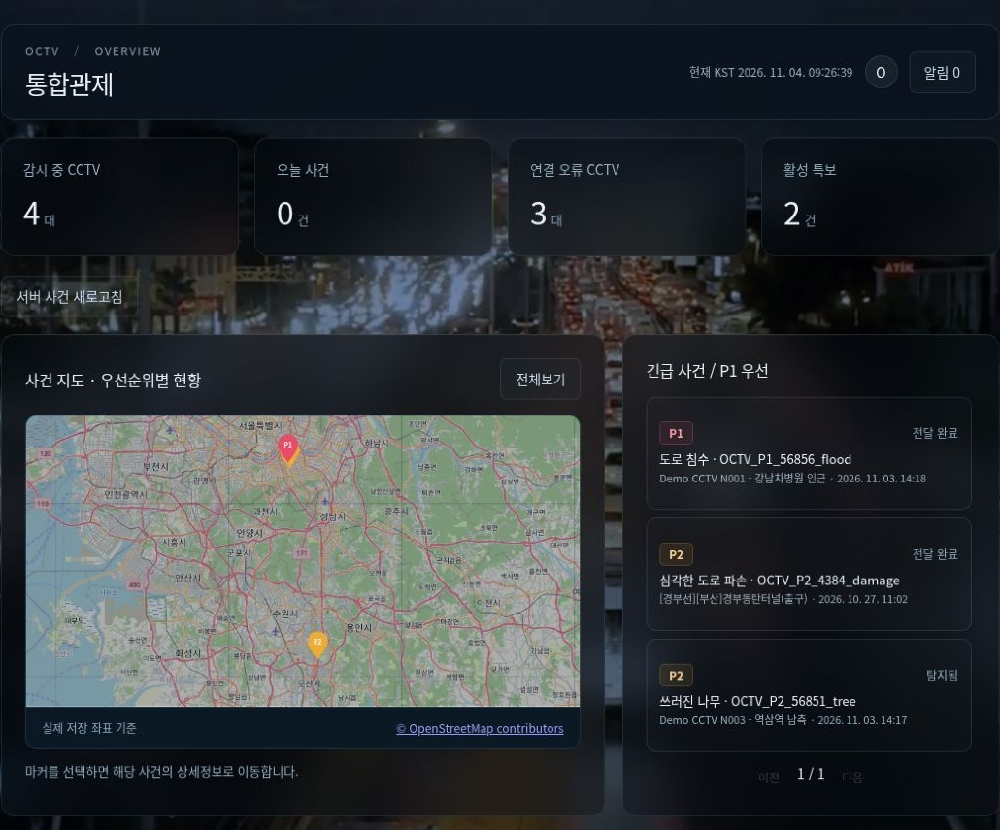
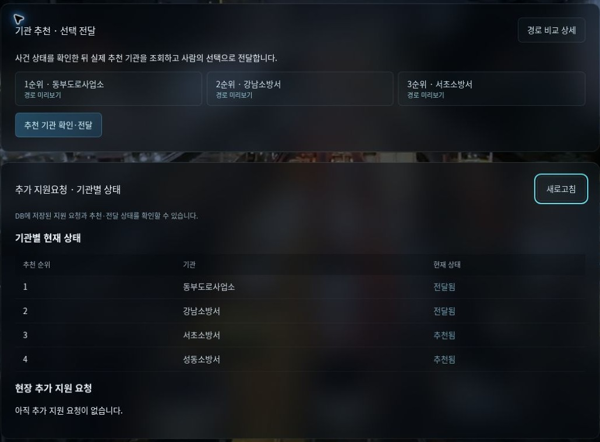
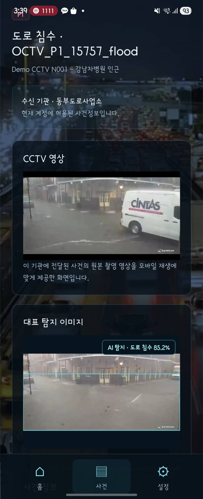
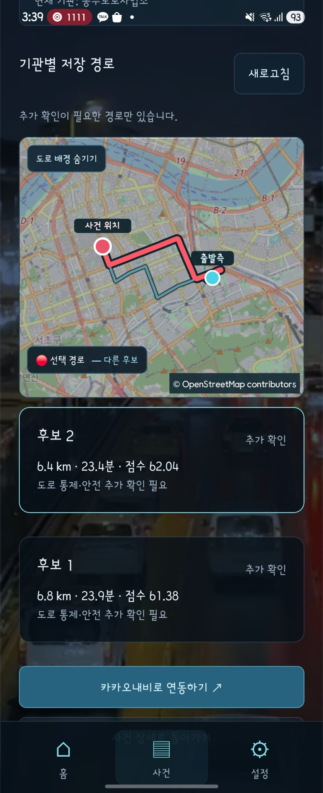

# OCTV · AI 재난 CCTV 대응 지원 시스템

> **재난을 찾은 다음, 어디부터 어떻게 대응할 것인가?**
> CCTV 탐지 결과에 기상·수위·교통 정보를 연결해 관제 요원의 **우선순위 판단과 기관·경로 선택**을 돕습니다.

`KDT 최종 프로젝트` · `2인 팀 · 팀장 이민재` · `2026.09 ~ 2026.11.03` · `최종 발표 완료`

저는 **외부 API·MCP 연동 → LangGraph 사건 분석 → 위험도·기관·경로 추천 → 기관 전달·FCM**을 구현하고, Docker 배포와 서비스 통합을 맡았습니다. 팀원의 CCTV 탐지·사건 생성 흐름에 판단과 대응 지원을 연결했습니다.

**아래 GIF는 상세페이지를 열면 자동 반복 재생됩니다.** 별도 링크나 재생 버튼을 누르지 않아도 됩니다. MP4는 고화질 보충 자료로만 제공합니다.

 

## 시연 1 · CCTV 영상과 YOLO 재난 탐지

**무엇을 하나요** — CCTV 영상과 YOLO 탐지 박스·신뢰도를 함께 확인합니다. 표시용 추론과 사건 생성은 별도 흐름입니다.

**이 장면을 보세요**

1. CCTV 영상의 침수 장면을 확인합니다.
2. flood 탐지 박스와 신뢰도가 영상에 표시됩니다.
3. 감지 결과가 관제 화면에 반영되는 모습을 확인합니다.

[고화질 MP4 (선택)](https://alswo0548.github.io/portfolio-showcase/#octv-cctv) · [탐지 이후의 처리 흐름 →](TECHNICAL.md#6-사건-처리-흐름)

운영 웹의 재난 시연 장면이며 실제 도로에서 현재 발생한 재난을 뜻하지 않습니다. GIF 속 박스 표시는 새 사건 생성 여부와 구분됩니다.

 

## 시연 2 · 사건 조회와 위험도 분석

**무엇을 하나요** — 저장된 사건의 위험도·우선순위와 기상·수위·교통 등 판단 근거를 함께 확인합니다.

**이 장면을 보세요**

1. 사건 상세에서 탐지 이미지와 위험도 정보를 확인합니다.
2. 분석 내용을 펼쳐 외부 정보와 판단 근거를 확인합니다.
3. 관측값의 출처·시각과 시연 설정값을 구분합니다.

통합관제 지도와 P1/P2 사건 목록은 아래 실제 운영 화면에서도 확인할 수 있습니다.

[통합관제 조회 MP4 (선택)](https://alswo0548.github.io/portfolio-showcase/#octv-overview) · [위험도 분석 MP4 (선택)](https://alswo0548.github.io/portfolio-showcase/#octv-analysis) · [MCP·위험도 계산 →](TECHNICAL.md#8-핵심-구현)

85점·P1, 수위 2.4m·차단 차로 2개는 DEMO 설정값입니다. 강수량 카드의 0mm는 저장 관측값이며 30mm는 시나리오 문구입니다. 지도는 정지 캡처이고, 상단 GIF는 실제 움직이는 분석 시연입니다.

 

## 시연 3 · 대응기관과 후보 경로 비교

**무엇을 하나요** — 추천 대응기관과 후보 경로를 지도·거리·시간·점수로 비교합니다.

**이 장면을 보세요**

1. 경로 비교 상세에서 추천 기관과 후보를 확인합니다.
2. 다른 후보를 선택해 경로와 점수를 비교합니다.
3. 기관 탭을 변경해 다른 출발지의 접근 경로를 확인합니다.

[고화질 MP4 (선택)](https://alswo0548.github.io/portfolio-showcase/#octv-routes) · [기관 선정·경로 평가 →](TECHNICAL.md#8-핵심-구현)

시연 시간·점수는 가상 교통상황이며 원본 API 결과와 구분됩니다. ‘추가 확인 필요’는 통제 정보가 미검증된 상태를 뜻합니다. 추천은 실제 출동 지령이나 안전한 주행을 보장하지 않습니다.

 

## 대응 지원 · 기관 전달과 모바일

관제 요원이 기관을 선택하면 전달 기록과 알림을 저장하고 FCM 발송을 요청합니다. 모바일은 React Native·Expo로 사건 조회와 대응 정보 확인을 연결했습니다. 실제 출동 지령·현장 대응 완료는 자동화 범위에 포함하지 않습니다.

위 이미지는 **기존 전달 기록 조회**입니다. 이번 녹화에서는 기관 전달·푸시 발송을 실행하지 않았습니다. 아래는 2026-11-05 제공받은 실제 모바일 실행 캡처입니다. 정지 이미지이며 푸시 수신이나 내비게이션 실행까지 검증한 영상은 아닙니다.

### 실제 모바일 대응 화면

| 전달받은 사건 확인 | 기관별 저장 경로 비교 |
|:---:|:---:|
|  |  |

- **사건 확인:** 수신 기관에 허용된 P1 침수 사건, CCTV 영상 영역, 대표 탐지 이미지를 한 화면에서 확인합니다. 캡처의 85.2%는 탐지 신뢰도이며 위험도 점수와 다릅니다.
- **경로 비교:** 출발측·사건 위치와 선택 경로·다른 후보를 지도에 표시하고 거리·시간·점수를 비교합니다. 두 후보 모두 ‘추가 확인’ 상태이므로 안전 경로가 보장된 것으로 설명하지 않습니다.
- **내비게이션 연결:** 카카오내비 연동 버튼이 표시됩니다. 이 캡처만으로 실제 내비게이션 실행이나 경로 회피 동작이 검증된 것은 아닙니다.

[모바일 사건 화면 원본 크기](../../assets/01-octv/mobile-incident.jpg) · [모바일 경로 화면 원본 크기](../../assets/01-octv/mobile-routes.jpg)

 

## 어떤 문제를 해결하나요

- 다수의 CCTV에서 발생한 피해를 사건 단위로 모아 **위치와 우선순위**를 확인합니다.
- 기상·수위·교통·주변 시설 정보를 정규화하고, 결측·오래된 값·미검증 정보를 구분합니다.
- 위험도와 기관·경로 추천 근거를 함께 제시해 **탐지 이후의 대응 의사결정**을 지원합니다.

 

## 최종 구현 범위와 담당 역할

| 영역 | 최종 구현 | 담당 |
|---|---|---|
| CCTV·탐지 | CCTV 수집·스트리밍·모니터링, YOLO 재난 탐지와 사건 생성 | 팀원 중심 |
| 외부 정보 | 기상·수위·교통 API 연동, 정규화·매핑·캐시, MCP 조회 도구 | **이민재** |
| 사건 분석 | LangGraph 7단계 흐름, 규칙 기반 위험도·P1/P2/P3 판단 | **이민재** |
| 추천 | 대응기관 선정, 후보 경로 조회·평가·재정렬 | **이민재** |
| 대응 지원 | 기관 전달, FCM 알림·중복 방지·재시도 | **이민재** |
| 모델·통합 | CCTV 환경 적응학습 모델 개발, Docker 배포·서비스 통합 | **이민재** |

**제가 맡은 부분** — 팀장으로서 외부 데이터와 사건 분석·대응 지원 백엔드를 연결했습니다. 탐지·사건 생성은 팀원의 주 담당 영역이며, 제가 담당한 사건 저장·조회·권한·판단 큐 기반과 통합했습니다. 적응학습은 별도 학습 환경에서 수행한 역할로, 저장소의 학습 진입점까지 완성된 자동 학습 파이프라인을 의미하지 않습니다.

 

## 기술 스택

| 구분 | 기술 및 사용 범위 |
|---|---|
| Backend | Python · FastAPI · Pydantic · psycopg — API·검증·SQL 저장 |
| Database | PostgreSQL · Atlas 마이그레이션 |
| 비동기 처리 | Redis · Celery — 분석/알림 작업 분리·락·캐시 |
| 사건 분석 | LangGraph — 상태 기반 처리 흐름 / FastMCP — 외부 상황 조회 도구 |
| 탐지·영상 | YOLO · OpenCV · MediaMTX · WebRTC / DEMO MP4·추론 JSON 표시 |
| Frontend | React · Vite · TypeScript (WEB), React Native · Expo (MOBILE) |
| 외부 연동 | 기상·수위·교통 API, Kakao Local·Mobility, Firebase Cloud Messaging |
| 배포 | Docker Compose · Caddy · DigitalOcean |

 

## 더 보기

- 📘 **[기술 상세 문서](TECHNICAL.md)** — 아키텍처, 판단 규칙, 비동기 처리, 문제 해결과 검증 범위
- 🌐 **[운영 웹사이트](https://209-97-168-207.sslip.io)** — 로그인 필요, 외부 API·CCTV 연결 상태에 따라 표시가 달라질 수 있습니다.
- 💻 **[소스코드](https://github.com/alswo0548/octv)** — 비공개 팀 저장소로 접근 권한이 필요합니다.

웹 시연 4개는 2026-11-04 23:46~23:49 KST 운영 서비스에서 연속 캡처했습니다. 전체 1348×926 화면과 실제 커서·클릭을 보존하고, 조작 사이의 대기 구간만 단축했습니다. 캡처 속도는 약 6~8fps이며 MP4는 15fps로 인코딩했습니다(중간 동작 생성 없음). 실제 서비스의 최대 재생 성능을 측정한 영상은 아닙니다. 위 GIF 3개는 보존된 실제 시연 자료를 상세페이지에 직접 삽입한 것입니다. 통합관제 지도는 정지 캡처로 구분하며 MP4 4개는 선택 사항입니다.

 

[← 포트폴리오 목록으로](../../README.md)
