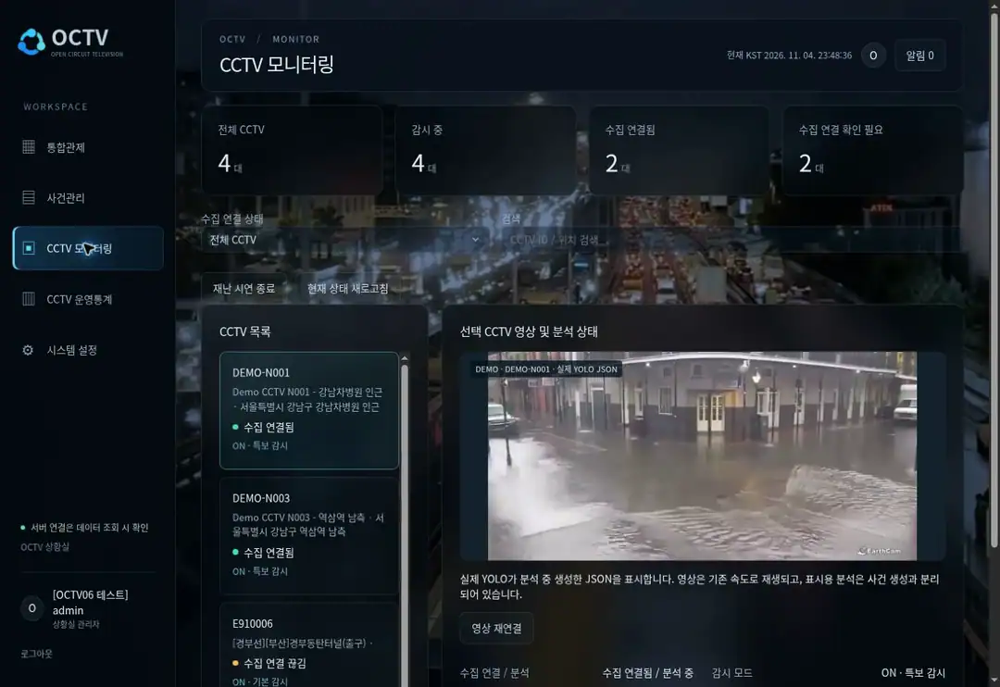
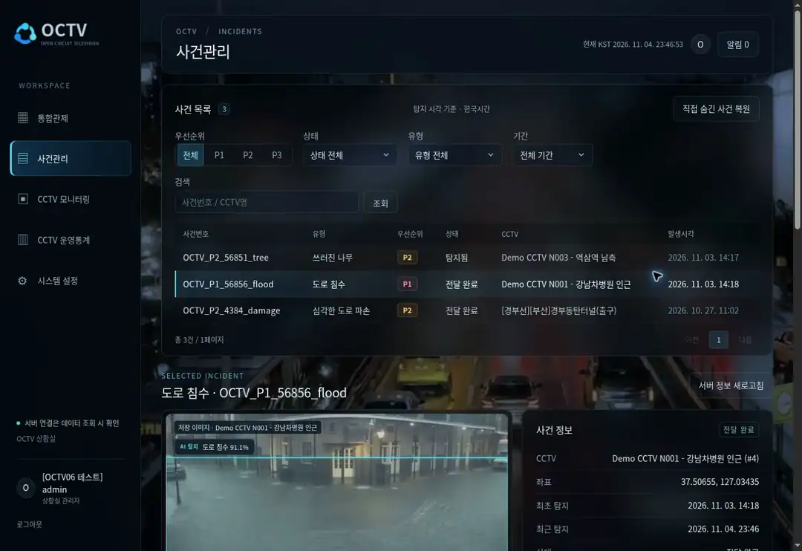

# OCTV · AI 재난 CCTV 대응 지원 시스템

> **재난을 찾은 다음, 어디부터 어떻게 대응할 것인가?**
> CCTV 탐지 결과에 기상·수위·교통 정보를 연결해 관제 요원의 **우선순위 판단과 기관·경로 선택**을 돕습니다.

`KDT 최종 프로젝트` · `2인 팀 · 팀장 이민재` · `2026.09 ~ 2026.11.03` · `최종 발표 완료`

저는 **외부 API·MCP 연동 → LangGraph 사건 분석 → 위험도·기관·경로 추천 → 기관 전달·FCM**을 구현하고, Docker 배포와 서비스 통합을 맡았습니다. 팀원의 CCTV 탐지·사건 생성 흐름에 판단과 대응 지원을 연결했습니다.

**아래 시연 2개는 상세페이지에서 바로 자동 반복 재생됩니다.** 클릭하거나 다른 페이지로 이동할 필요가 없습니다. 기존 운영 웹 전체 화면 녹화(1348×926)를 바탕으로, 좌측 메뉴·상단·작업 영역을 잘라내지 않은 애니메이션 WebP(1080×742)로 경량화했습니다.

 

## 시연 1 · CCTV 재난 탐지 → 통합관제

**시연 흐름:** CCTV 모니터링에서 flood 탐지 박스·신뢰도와 수집 상태 확인 → 통합관제 지도와 사건 목록 조회.

실제 녹화된 두 웹 화면을 순서대로 재생합니다. 왼쪽 메뉴와 페이지 상단, 작업 화면 전체가 유지되며 **CCTV 영상 부분만 잘라 보여주지 않습니다.** 화면에 그리는 YOLO 추론과 사건 생성은 구분됩니다.

원본 확인(선택): [CCTV 모니터링 MP4](https://alswo0548.github.io/portfolio-showcase/#octv-cctv) · [통합관제 MP4](https://alswo0548.github.io/portfolio-showcase/#octv-overview). 재생을 위해 링크를 클릭할 필요는 없습니다. 실제 도로의 현재 재난이 아닌 DEMO 시연입니다.

 

## 시연 2 · 위험도 분석 → 대응기관·경로 추천

**시연 흐름:** 사건 상세에서 위험도·우선순위·외부 상황 확인 → 추천기관 변경 → 후보 경로의 지도·거리·시간·점수 비교.

사건 분석과 경로 평가의 **전체 웹 화면**을 연속 재생합니다. 위험도 85점·P1, 수위 2.4m, 차단 차로 2개는 DEMO 시나리오 값입니다. 강수량 카드의 0mm는 저장된 관측값이며, 30mm 시나리오 문구와 구분합니다. ‘추가 확인 필요’는 통제 정보를 검증하지 못한 상태이며, 안전 경로와 실제 출동 지령을 보장하지 않습니다.

원본 확인(선택): [위험도 분석 MP4](https://alswo0548.github.io/portfolio-showcase/#octv-analysis) · [기관·경로 MP4](https://alswo0548.github.io/portfolio-showcase/#octv-routes) · [구현 상세](TECHNICAL.md#8-핵심-구현)

 

## 대응 지원 · 기관 전달과 모바일

관제 요원이 기관을 선택하면 전달 기록과 알림을 저장하고 FCM 발송을 요청합니다. 모바일은 React Native·Expo로 사건 조회와 대응 정보 확인을 연결했습니다. 실제 출동 지령·현장 대응 완료는 자동화 범위에 포함하지 않습니다.

위 이미지는 **기존 전달 기록 조회**입니다. 이번 녹화에서는 기관 전달·푸시 발송을 실행하지 않았습니다. 아래는 2026-11-05 제공받은 실제 모바일 실행 캡처입니다. 정지 이미지이며 푸시 수신이나 내비게이션 실행까지 검증한 영상은 아닙니다.

### 실제 모바일 대응 화면

| 전달받은 사건 확인 | 기관별 저장 경로 비교 |
|:---:|:---:|
|  |  |

- **사건 확인:** 수신 기관에 허용된 P1 침수 사건, CCTV 영상 영역, 대표 탐지 이미지를 한 화면에서 확인합니다. 캡처의 85.2%는 탐지 신뢰도이며 위험도 점수와 다릅니다.
- **경로 비교:** 출발측·사건 위치와 선택 경로·다른 후보를 지도에 표시하고 거리·시간·점수를 비교합니다. 두 후보 모두 ‘추가 확인’ 상태이므로 안전 경로가 보장된 것으로 설명하지 않습니다.
- **내비게이션 연결:** 카카오내비 연동 버튼이 표시됩니다. 이 캡처만으로 실제 내비게이션 실행이나 경로 회피 동작이 검증된 것은 아닙니다.

[모바일 사건 화면 원본 크기](../../assets/01-octv/mobile-incident.jpg) · [모바일 경로 화면 원본 크기](../../assets/01-octv/mobile-routes.jpg)

 

## 어떤 문제를 해결하나요

- 다수의 CCTV에서 발생한 피해를 사건 단위로 모아 **위치와 우선순위**를 확인합니다.
- 기상·수위·교통·주변 시설 정보를 정규화하고, 결측·오래된 값·미검증 정보를 구분합니다.
- 위험도와 기관·경로 추천 근거를 함께 제시해 **탐지 이후의 대응 의사결정**을 지원합니다.

 

## 최종 구현 범위와 담당 역할

| 영역 | 최종 구현 | 담당 |
|---|---|---|
| CCTV·탐지 | CCTV 수집·스트리밍·모니터링, YOLO 재난 탐지와 사건 생성 | 팀원 중심 |
| 외부 정보 | 기상·수위·교통 API 연동, 정규화·매핑·캐시, MCP 조회 도구 | **이민재** |
| 사건 분석 | LangGraph 7단계 흐름, 규칙 기반 위험도·P1/P2/P3 판단 | **이민재** |
| 추천 | 대응기관 선정, 후보 경로 조회·평가·재정렬 | **이민재** |
| 대응 지원 | 기관 전달, FCM 알림·중복 방지·재시도 | **이민재** |
| 모델·통합 | CCTV 환경 적응학습 모델 개발, Docker 배포·서비스 통합 | **이민재** |

**제가 맡은 부분** — 팀장으로서 외부 데이터와 사건 분석·대응 지원 백엔드를 연결했습니다. 탐지·사건 생성은 팀원의 주 담당 영역이며, 제가 담당한 사건 저장·조회·권한·판단 큐 기반과 통합했습니다. 적응학습은 별도 학습 환경에서 수행한 역할로, 저장소의 학습 진입점까지 완성된 자동 학습 파이프라인을 의미하지 않습니다.

 

## 기술 스택

| 구분 | 기술 및 사용 범위 |
|---|---|
| Backend | Python · FastAPI · Pydantic · psycopg — API·검증·SQL 저장 |
| Database | PostgreSQL · Atlas 마이그레이션 |
| 비동기 처리 | Redis · Celery — 분석/알림 작업 분리·락·캐시 |
| 사건 분석 | LangGraph — 상태 기반 처리 흐름 / FastMCP — 외부 상황 조회 도구 |
| 탐지·영상 | YOLO · OpenCV · MediaMTX · WebRTC / DEMO MP4·추론 JSON 표시 |
| Frontend | React · Vite · TypeScript (WEB), React Native · Expo (MOBILE) |
| 외부 연동 | 기상·수위·교통 API, Kakao Local·Mobility, Firebase Cloud Messaging |
| 배포 | Docker Compose · Caddy · DigitalOcean |

 

## 더 보기

- 📘 **[기술 상세 문서](TECHNICAL.md)** — 아키텍처, 판단 규칙, 비동기 처리, 문제 해결과 검증 범위
- 🌐 **[운영 웹사이트](https://209-97-168-207.sslip.io)** — 로그인 필요, 외부 API·CCTV 연결 상태에 따라 표시가 달라질 수 있습니다.
- 💻 **[소스코드](https://github.com/alswo0548/octv)** — 비공개 팀 저장소로 접근 권한이 필요합니다.

웹 시연 4개는 2026-11-04 23:46~23:49 KST 운영 서비스에서 연속 캡처했습니다. 전체 1348×926 화면과 실제 커서·클릭을 보존하고, 조작 사이의 대기 구간만 단축했습니다. 캡처 속도는 약 6~8fps이며 MP4는 15fps로 인코딩했습니다(중간 동작 생성 없음). 실제 서비스의 최대 재생 성능을 측정한 영상은 아닙니다. 새 자동재생 애니메이션 2개는 전체 웹 화면을 녹화한 MP4 4개에서 실제 프레임을 추출해 이어 붙였습니다. 원본은 1348×926이며 표시용 파일은 1080×742입니다. 프레임을 간격 추출하고 일부 대기 구간을 단축했으나, UI를 새로 만들거나 화면 일부만 잘라내지 않았습니다. 원본 MP4와 기존 GIF는 검증·보존용으로 유지하고 상세페이지에는 두 전체 화면 시연만 표시합니다.

 

[← 포트폴리오 목록으로](../../README.md)
